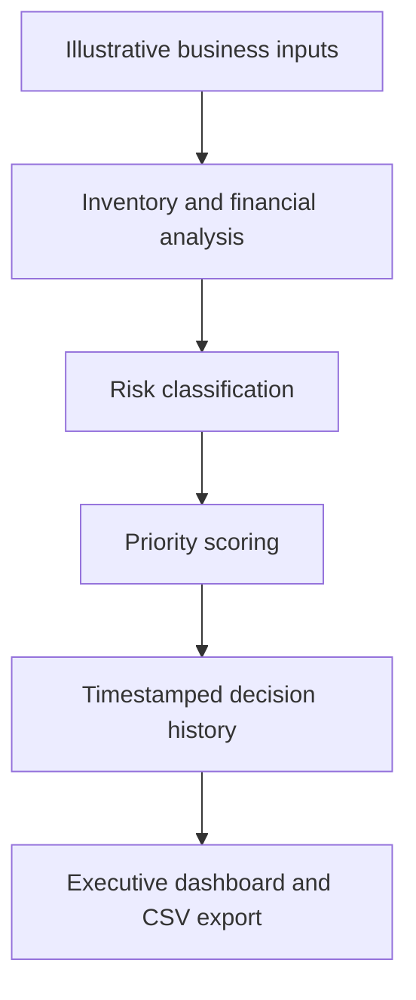

# AEGIS | Enterprise Decision Intelligence

**Business analysis · Operational risk · Financial intelligence · Executive dashboards**

**Status:** Functional prototype | **Stack:** Python, Streamlit, Pandas, Plotly, JSON | **Repository:** Public showcase · Application source: private

## Executive summary

AEGIS is a modular decision-support prototype that evaluates competing business concerns, classifies risks, ranks departmental priorities, records assessments, and presents results in an interactive executive dashboard. It demonstrates how industrial engineering, business analysis, and Python-based analytics can turn operational signals into a structured management view.

The prototype uses illustrative scenarios and predefined business rules. It is **not** a production autonomous decision-maker or a trained AI forecasting system.

## Business case: competing operational priorities

**Illustrative organization:** A mid-sized distributor faces an inventory shortage while also managing financial constraints. Departmental reports are disconnected; leadership needs to understand which concern is more urgent, why, and how assessments evolve over time.

**Business challenge:** Without a shared prioritization method, teams may escalate issues inconsistently, overlook critical risks, and lack an accessible record of previous assessments.

**Objective:** Consolidate risk classification, priority scoring, decision history, and management reporting in one repeatable workflow.

### Illustrative scenario and output

| Dimension | Inventory management | Financial management |
|---|---|---|
| Operational context | Stock below minimum | Financial pressure |
| Example inputs | 120 units on hand; 150-unit minimum; 25 units/day demand | Financial inputs evaluated by rules engine |
| Prototype risk classification | CRITICAL | HIGH |
| Prototype priority score | 4.45 | 3.70 |

**Interpretation:** Under the configured scoring rules, inventory receives the higher priority. This is a decision-support signal, not a guarantee that replenishment is always the financially optimal action. Actual decisions would also require cash-flow, supplier, service-level, and business-context review.

These figures are **illustrative test data**, not results from a real client deployment.

## Solution and architecture

AEGIS separates business logic from presentation and recordkeeping:

### Module responsibilities

| File | Responsibility |
|---|---|
| `app/main.py` | Runs the example enterprise analysis workflow |
| `app/decision_engine.py` | Implements business decision logic, including inventory analysis |
| `app/financial_engine.py` | Evaluates financial conditions using defined rules |
| `app/risk_engine.py` | Supports operational risk classification |
| `app/priority_engine.py` | Scores and ranks competing priorities |
| `app/decision_history.py` | Saves and retrieves timestamped decision records; includes duplicate-prevention logic |
| `app/dashboard.py` | Provides filters, metrics, charts, alerts, history, and CSV export |

## Executive dashboard capabilities

- **Executive overview:** recorded assessments, departments, critical-risk records, and average priority score.
- **Risk alerts:** prominently identifies critical-risk departments within the selected records.
- **Priority ranking:** compares the latest assessment for each department.
- **Risk distribution:** donut chart of risk classifications.
- **Priority trends:** historical score visualization by department.
- **Interactive filters:** department and risk-level selection.
- **Decision history:** timestamped table with downloadable CSV.

**Important distinction:** The dashboard's critical-risk count represents recorded entries, not necessarily distinct unresolved incidents. Trend lines show saved assessments, not predictive forecasts. The current prototype uses local JSON storage rather than a multi-user production database.

## Example workflow

1. Define operational and financial scenario inputs.
2. Execute the Python analytical workflow.
3. Apply risk and priority evaluation rules.
4. Record timestamped departmental assessments.
5. Review results in the Streamlit dashboard.
6. Filter, compare, and export decision history.

## Demonstration and source access

This repository publishes the business case and design overview only. Application code and local decision-history files remain in a separate private repository. No live hosted demo is currently provided.

## Validation and limitations

**Manually exercised during development:** analytical execution, history retrieval, duplicate handling, Streamlit startup, KPI display, department and risk filtering, critical alerts, ranking and trend charts, and CSV export.

**Not yet established:** automated test coverage, production data integration, scoring-model calibration, security review, authentication, concurrent-write safety, service-level guarantees, or measured business ROI.

The system is a **functional portfolio prototype** demonstrating design and integration rather than a deployed enterprise product.

## Potential business applications

- **Supply chain:** flag inventory shortages and prioritize replenishment reviews.
- **Manufacturing:** compare operational constraints and production risks.
- **Retail:** consolidate stock and financial concerns into management reporting.
- **Business consulting:** demonstrate a transparent, repeatable decision-scoring framework.
- **Operations leadership:** review trends and maintain a basic assessment history.

### Potential value, not measured outcomes

AEGIS is designed to improve visibility, consistency, escalation, and traceability. No quantified savings, risk reduction, or efficiency gains are claimed without real-world validation.

## Development roadmap

1. Add automated unit and integration tests, input validation, and error handling.
2. Replace local JSON storage with a database and reliable concurrent writes.
3. Introduce configurable scoring weights and transparent score explanations.
4. Add ERP/API ingestion and scheduled refreshes.
5. Implement authentication, permissions, audit controls, and monitoring.
6. Add scenario comparison, sensitivity analysis, and eventually validated predictive models.

## Engineering approach

**Problem definition → requirements → modular analytical design → implementation → functional verification → executive reporting → improvement roadmap.**

AEGIS demonstrates the combination of business analysis, industrial engineering, Python automation, operational risk assessment, and business intelligence in a single decision-support workflow.

---

**AEGIS — Enterprise Decision Intelligence**  
*Portfolio case study | Illustrative business data | Functional prototype*

## Who it benefits

Business owners, executives and departmental analysts: consistent comparison of operational risks, ranked priorities and recorded assessments.

These are intended users and benefits, not evidence of adoption or measured customer outcomes.
